

<h1>Enhanced Problems</h1>

developed and maintained by

and community

<strong>The Zabbix Problems widget, with the filtering and layout an operations wall actually needs.</strong> 
Zabbix's own Problems widget shows one list, the same way, for everyone looking at it. Enhanced Problems lets a dashboard say what this particular screen is for: which columns, how large, in what colour, and which problems belong on it at all.

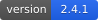

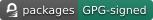

<a href="#what-you-can-build"><strong>Features</strong></a> &nbsp;·&nbsp;
<a href="#examples"><strong>Examples</strong></a> &nbsp;·&nbsp;
<a href="#install"><strong>Install</strong></a> &nbsp;·&nbsp;
<a href="#free-vs-pro"><strong>FREE vs PRO</strong></a> &nbsp;·&nbsp;
<a href="https://portal.initmax.com"><strong>Portal</strong></a> &nbsp;·&nbsp;
<a href="https://www.initmax.com/wiki/enhanced-problems/"><strong>Docs</strong></a>

 

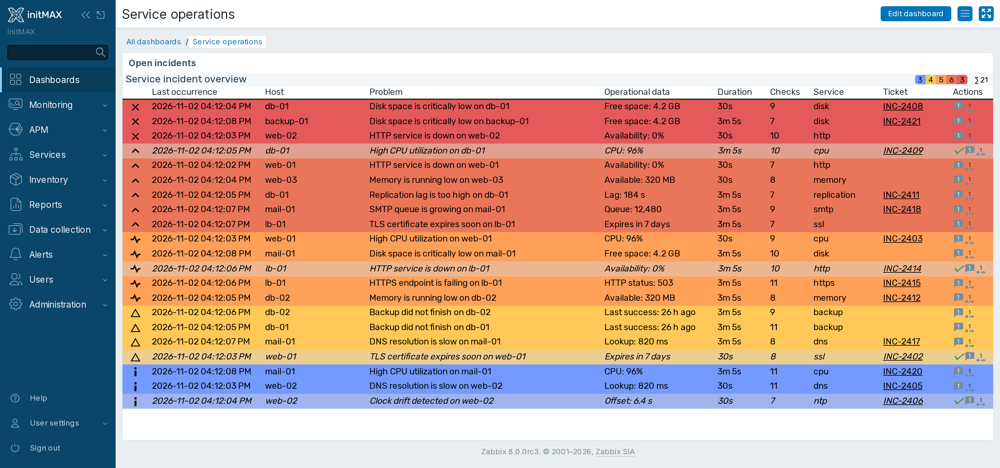

---

## Why Enhanced Problems

A problems list is the one widget that ends up on every wall display, every NOC screen and every team's own dashboard - and each of those wants something different from it. One wants the host column wide and everything else gone; another wants severity counts at a glance from ten metres away; a third wants to acknowledge without leaving the page.

Enhanced Problems is that widget with those decisions handed back to whoever builds the dashboard.

## What you can build

<table>
<tr>
<td width="50%" valign="top">

**Your own column set**

Choose which columns appear and how wide each one is - a problems list that fits the screen it runs on. Next to Host, Problem and the times, **Operational data (PRO)** shows what Monitoring > Problems shows there, **Duration (PRO)** how long the problem has lasted, and a narrow **Severity icon (PRO)** column the severity as a glyph. Any tag can have a column of its own - a custom column with source *Tag* - and **All tags** in the context menu, or the "⋯" of the Tags column, shows every tag of a problem. **All tags display** chooses the native **Zabbix popup** with tag badges (the default) or a name/value **List**. Both preserve repeated tag names and empty values, and treat tag names and values as plain text, including HTML-looking content. The choice is per widget and travels with its appearance preset.

</td>
<td width="50%" valign="top">

**Readable from across the room**

Font size and colours are yours to set, made for wall displays. Every colour picker offers live light/dark previews, Apply and Use default, including the title and severity colours.

</td>
</tr>
<tr>
<td width="50%" valign="top">

**Subtitle with severity counts** PRO

A second bar under the title, styled the same way - font, size, colours, bold, italic, underline and alignment - with problem counts per severity on its right. Choose whether zero counts remain visible, independently of which problems are counted.

</td>
<td width="50%" valign="top">

**Acknowledge in place**

Acknowledge a problem straight from the widget, no detour to the Problems page.

</td>
</tr>
<tr>
<td width="50%" valign="top">

**Filter like the stock widget**

Host group, host, severity and tags stay FREE, together with literal text found anywhere in the problem name. PRO adds `*` patterns such as `Disk*` and regular expressions after `regex:`; these are separate from the original Count extraction regex, which remains FREE.

</td>
<td width="50%" valign="top">

**Sorting by several columns**

FREE sorts by one of the original criteria, including First occurrence tag. PRO adds sorting by any custom column and up to ten sorting levels, so rows can be ordered by severity, then time, then host or another value.

</td>
</tr>
<tr>
<td width="50%" valign="top">

**Presets**

Save how the widget looks under a name - columns and their order, custom columns, sorting, fonts and colours - and load it on any dashboard, where the widget keeps its own filter and the texts and links of its title and subtitle. Shared by every Enhanced Problems widget on the frontend.

</td>
<td width="50%" valign="top">

**One ticket for a selection** PRO

Select ten problems, press *Create ticket*: one call to your ticket system, its number noted on all ten and shown in a column. Press again and the ten are left alone.

</td>
</tr>
</table>

## Examples

<table>
<tr>
<td width="50%" align="center" valign="top">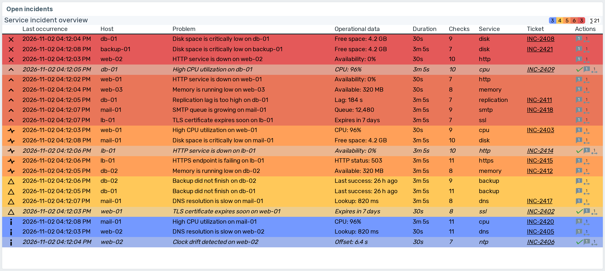 <small><b>Problems</b> - Twenty-one open problems across eight hosts, sorted by severity, with the per-severity counters in the subtitle.</small></td>
<td width="50%" align="center" valign="top">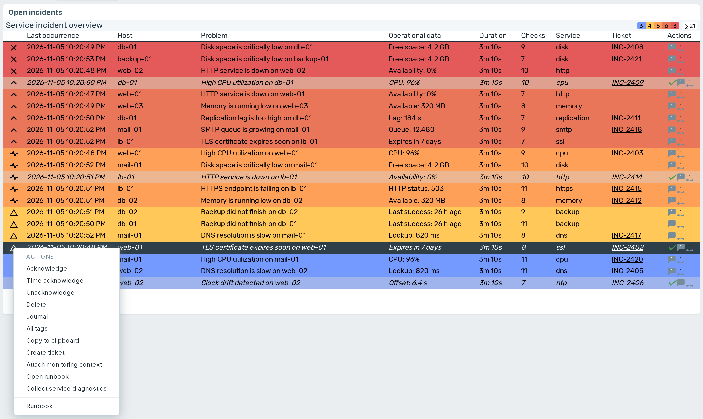 <small><b>Action buttons (PRO)</b> - right-click a problem to see the administrator's ticket, context, runbook and diagnostic buttons alongside the built-in actions.</small></td>
</tr>
<tr>
<td colspan="2" align="center" valign="top">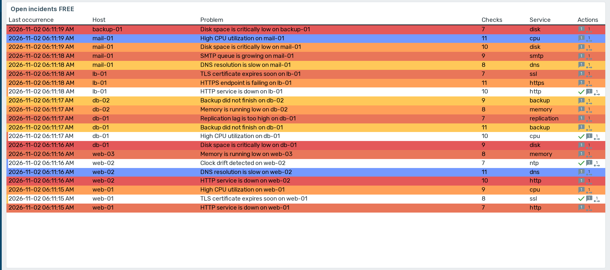 <small><b>FREE table</b> - The original Count and unlimited Tag columns stay available. This separate FREE build shows the same incidents without the new PRO-only columns.</small></td>
</tr>
</table>

## Configuration

Built-in column names follow the viewing user's language. A custom **Label** stays as entered. PRO-only controls are marked with a padlock and upgrade link in FREE; the original FREE options stay available.

Everything lives in one familiar widget form. The **Presets** row on top saves the columns, sorting and appearance under a name and loads them back on any dashboard, leaving the widget's filter and the texts and links of its title and subtitle as they are - Load, Update, Save as preset and Remove (saving and removing take a Super admin; everyone can load).

**Custom columns** keeps unlimited *Tag* columns in FREE, together with the original *Count*, *First occurrence tag* and URL-tag menu link. PRO adds independent *Update message* columns and per-column links:

- **Name** - the column heading.
- **Source** - *Tag* remains FREE without a numerical limit. *Update message* is FREE for the original *Count* only; additional message-extraction columns require PRO. *Update message* reads the latest update message that matches a **Regular expression** (its first capturing group is the value, e.g. `(?i)^ticket:\s*(\S+)` reads `4711` from `Ticket: 4711`); enable *A match updates the Last occurrence column to the time of the matching message* when a matching message should also move the Last occurrence column. *Tag* reads the value of the named **Tag**.
- **URL link (PRO)** - optional; makes the value a link that opens in a new tab. `{RESPONSE}` is the value, and the problem macros work too: `{EVENT.ID}`, `{EVENT.NAME}`, `{EVENT.SEVERITY}`, `{EVENT.TIME}`, `{EVENT.COUNT}`, `{EVENT.LAST}`, `{HOST.NAME}`, `{HOST.HOST}`, `{TRIGGER.ID}`, `{EVENT.TAGS.<name>}`, `{USER.USERNAME}`, `{USER.NAME}`, `{USER.SURNAME}`, `{USER.FULLNAME}`, `{DATE}`, `{TIME}`, `{DATETIME.ISO}`. Every value is URL-encoded. A column has one value, so `{RESPONSE.<name>}` and `{RESPONSE1}` are that value too: a button that writes `ticket:{RESPONSE.id}` into the note and a link ending in `/ticket/{RESPONSE.id}` open the same ticket. With no link, the value itself is the address when it is one: an address with a scheme, or a path inside this Zabbix such as `zabbix.php?action=problem.view&...`; a link that is one macro alone, e.g. `{RESPONSE}`, uses its value the same way. A value that would leave the site without a scheme (`//host`, `\\host`, `/\host`) is never an address. Every address has to pass the frontend's URI scheme policy (Administration -> General -> Other: *Validate URI schemes* and *Valid URI schemes*).
- **Link target (PRO)** - where the link goes. *Column*: the cell is the link. *Context menu*: the cell shows the value as text, and the problem's context menu gets an item named like the column that opens the link, enabled when one problem is selected and it has an address. Any number of columns can use the context menu; their items follow the built-in ones, in the custom columns' order.

Each custom column is also listed under Columns, where it is switched on, ordered, sized and relabelled like any other column, and, in PRO, offered as a sorting column of every sorting row (FREE retains the original *First occurrence tag* sort criterion) - natural and case-insensitive (`9` before `10`). New custom sorts put problems without a value last in either order; the original *First occurrence tag* keeps its earlier missing-value ordering. A row whose custom column is removed sorts by *First occurrence*, and presets carry the custom columns with the rest of the look. A column for a tag is a custom column with source *Tag*; the tag list of earlier releases is gone, and each of its tags became such a custom column, named like the tag, with its place, width and label kept. A ticket number is one custom column: name *Ticket No.*, source *Update message*, pattern `(?i)^ticket:\s*(\S+)`, link `https://helpdesk.example.com/ticket/{RESPONSE}`.

Per-column **URL link**, **Select dashboard** and **Link target** are PRO features. FREE displays custom values as plain text and keeps the single legacy URL-tag context-menu link converted from earlier FREE settings. Stored PRO link settings cannot enable additional links in FREE.

The original fixed controls remain available as *Count*, *First occurrence tag* and *URL*, even when their columns are not displayed. Their settings and the old tag columns are carried over without changing labels, widths or order. An undisplayed *Count* still dates *Last occurrence* when its original setting says so; an empty old URL tag stays empty. A PRO widget that explicitly removes its custom rows can keep that empty list. FREE keeps the three fixed controls available, because they were always configurable in the released FREE version.

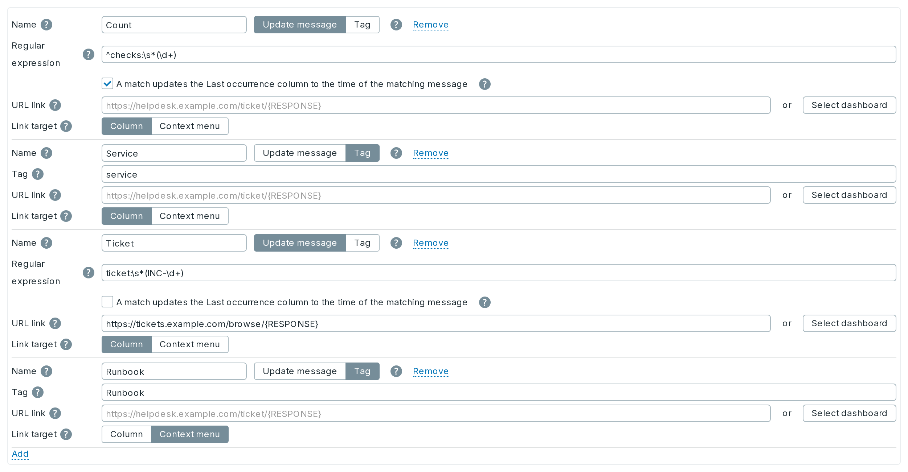 
<small><b>Custom columns in PRO</b> - Original Count and Service from a Tag sit next to an additional Ticket extraction column with its own URL link and Link target.</small>

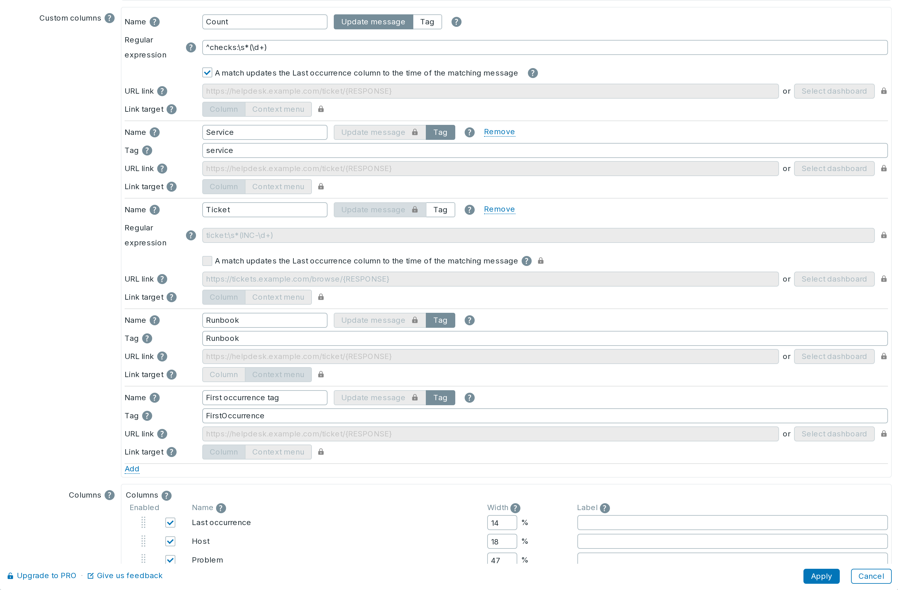 
<small><b>Custom columns in FREE</b> - Original Count and Tag controls remain available; only the new capabilities are individually locked, with Upgrade, Apply and Cancel visible.</small>

Only additions require PRO: independent *Update message* columns; **URL link**, **Select dashboard** and **Link target**; wildcard/regex modes of **Problem**; **Severity icon**, **Operational data**, **Duration**; **Host groups** from another widget and **Hosts** from another widget or the dashboard (7.0+); arbitrary custom-column sorting; sticky headers; new list styles and *Inherit from Zabbix* / *Oxanium*. Existing FREE tag columns, one-level sorting, manual host/group filtering, fonts including *Rubik*, colours, presets and acknowledgement operations remain FREE.

On Zabbix 7.0+, PRO **Host groups** can follow another widget; **Hosts** can follow another widget or the host selected at the top of the dashboard. Manual host/group selection remains FREE.

**Problems sorting** is a list of sorting rows, the top one first, edited like the custom columns: each row is a column - a built-in one or a custom column - and *ASC* or *DESC*, and orders the problems that tie on every row above it. FREE has one row; PRO adds rows with *Add*, up to ten, and takes them out with *Remove*, one row always staying. A widget or a preset saved by an earlier release keeps its order: its first sorting level becomes the first row, and the second and the third level, where they were switched on, the rows after it. A widget saved in PRO with several rows sorts by its first row in FREE. **Maximum displayed alarms** is applied after the configured sorting, so a small display limit keeps the first problems in that order. Regex filters check the newest candidates before sorting the matches; the candidate limit is the greater of the frontend search limit and Maximum displayed alarms.

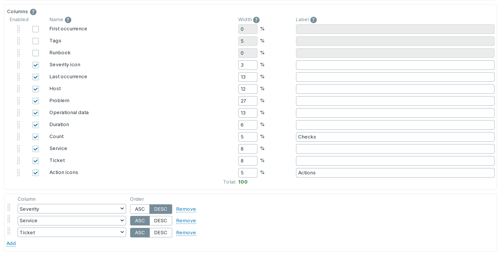

The time acknowledge dialog reflects the latest accepted suppression or unsuppression immediately, including while Zabbix finishes processing the action.

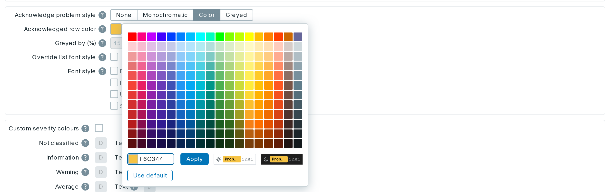 
<small><b>Acknowledged-row preview (PRO)</b> - The Color picker previews a pending background and readable text in Light and Dark. The overview uses the saved Greyed style.</small>

## Install

**FREE** ships as **GPG-signed `deb` / `rpm` packages** from the initMAX repository - `apt` / `dnf` installs them and keeps them updated.

### Easiest way - the guided installer on the Portal

Open the product page, pick your **OS** and **edition**, and copy the ready-made command. FREE is fully public (no login); PRO fills in your token once you sign in. There's a feedback box right there too.

<a href="https://portal.initmax.com/catalog/zabbix-enhancedproblems#how-to-install">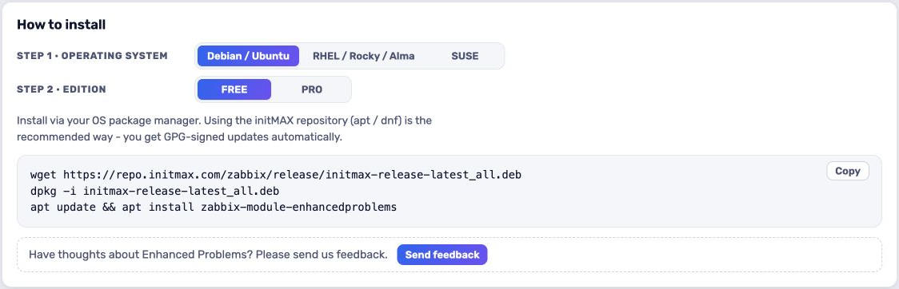</a>

<a href="https://portal.initmax.com/catalog/zabbix-enhancedproblems#how-to-install"><strong>→ Open the installer on the Portal</strong></a>

Prefer a plain archive? Every release also ships as a **ZIP** [straight from the repo](https://repo.initmax.com/zabbix/free/zip/enhancedproblems/) - handy for offline or manual installs.

The module is enabled automatically during the package installation - verify it in **Administration → General → Modules**. Done.

## Action buttons (PRO)

An action button is a context-menu entry the administrator defines in **Administration → Enhanced Problems**. It is one of two things: a **webhook** - an HTTP request shaped like an HTTP agent item (URL, query fields, headers, GET/POST/PUT, body) - or a **Zabbix script** picked from Alerts → Scripts (a manual host or event action), run as the operator pressing it, with the operator's input handed over as the script's manual input (Zabbix 7.0+). Either fires with the problem's macros filled in - `{EVENT.ID}`, `{EVENT.NAME}`, `{HOST.NAME}`, `{EVENT.TAGS.<name>}`, `{USER.USERNAME}`, `{MANUALINPUT}` and the rest are listed next to the form.

**Send from** chooses where a webhook is performed:

- **Frontend server** sends it from the Zabbix frontend. This mode supports Authentication, user macros and the response workflow below.
- **Browser** sends it from the operator's browser. Cross-origin requests need the target's CORS permission, and an HTTPS frontend cannot call a plain HTTP target. The browser's normal cookie, header and redirect rules apply; this mode does not bypass them. Its request data is visible to the operator, so Authentication fields and Zabbix user macros are not available.
- **Open in a dialog** opens the resolved URL in an embedded page, with an **Open in a new tab** link. The target's embedding policy can block the frame. This mode does not send the configured HTTP body or headers and cannot use Authentication fields or Zabbix user macros.

If a configuration fails validation, the form keeps all unsaved button cards and their values so the administrator can correct them and try **Update** again.

A webhook runs **once per problem** or **once for the whole selection**. In the second case one call carries the selection - `{SELECTION.COUNT}`, `{SELECTION.EVENT.IDS}`, `{SELECTION.HOST.NAMES}`, `{SELECTION.TEXT}` (one line per problem) and `{SELECTION.JSON}` (an array of objects for a JSON body) - and, with **Frontend server**, the configured note lands on every selected problem. **Skip problems already handled** names the note the button writes (`^ticket:`), so a problem that carries it is left alone and reported as such rather than ticketed twice. Worked examples:

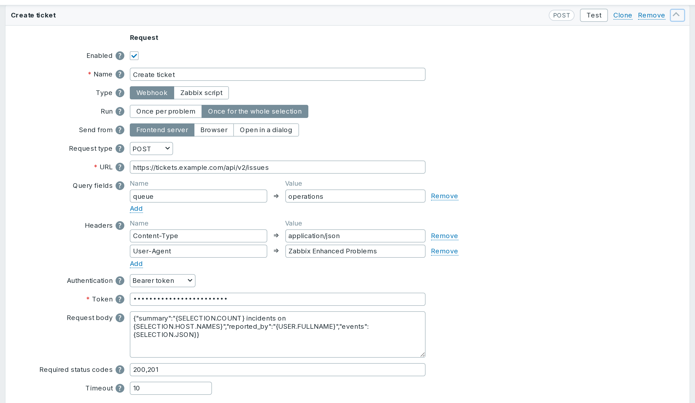

**1. Create a ticket and record its number**

| field | value |
| --- | --- |
| Send from | Frontend server |
| Request type | POST · `https://helpdesk.example.com/api/tickets` |
| Headers | `Content-Type: application/json` |
| Authentication | Bearer token · `{$HELPDESK_TOKEN}` |
| Request body | `{"messageId": "ZBX{EVENT.ID}-{TIME}", "timestamp": "{DATETIME.ISO}", "title": "{EVENT.NAME}", "host": "{HOST.NAME}", "severity": "{EVENT.SEVERITY}", "zabbix_event": "{EVENT.ID}", "opened_by": "{USER.USERNAME}"}` |
| Read from response | `id ⇒ ticket.id` and `url ⇒ ticket.url` - the answer is `{"ticket": {"id": 4711, "url": "..."}}`; each row is a macro by number, `{RESPONSE1}` and `{RESPONSE2}`, and by name, `{RESPONSE.id}` and `{RESPONSE.url}` (the first row is also plain `{RESPONSE}`) |
| Show to operator | `Ticket {RESPONSE.id} created for {HOST.NAME}: {RESPONSE.url}` |
| Note on the problem | `ticket:{RESPONSE.id}` - lands in the problem's journal, where a custom column can read it |
| Follow-up button | *Annotate ticket* (example 2) |

**2. Annotate the ticket that was just created** - the follow-up, fired with `{RESPONSE}` already filled in

A follow-up is one additional webhook sent from **Frontend server**. Configure its own request and Authentication; credentials are not inherited from the first button. The follow-up receives the first button's response macros and uses its permissions, but does not start another follow-up.

| field | value |
| --- | --- |
| Send from | Frontend server |
| Request type | POST · `https://helpdesk.example.com/api/tickets/{RESPONSE}/notes` |
| Headers | `Content-Type: application/json` |
| Authentication | Bearer token · `{$HELPDESK_TOKEN}` |
| Request body | `{"text": "Opened from Zabbix by {USER.FULLNAME}: {EVENT.NAME} on {HOST.NAME}, {EVENT.COUNT} occurrences, last {EVENT.LAST}"}` |
| Response | Hidden |

**0. One ticket for the whole selection** - the ticket workflow end to end

| field | value |
| --- | --- |
| Run | Once for the whole selection |
| Skip problems already handled | `^ticket:` |
| Request type | POST · `https://helpdesk.example.com/api/tickets` |
| Request body | `{"summary": "{SELECTION.COUNT} problems on {SELECTION.HOST.NAMES}", "reporter": "{USER.USERNAME}", "problems": {SELECTION.JSON}}` |
| Confirmation | `Open ONE ticket for {SELECTION.COUNT} selected problems on {SELECTION.HOST.NAMES}?` |
| Read from response | `key ⇒ ticket.key` |
| Show to operator | `Ticket {RESPONSE.key} created for {SELECTION.COUNT} problems` |
| Note on the problem | `ticket: {RESPONSE.key}` - written on every selected problem; a custom column with the pattern `(?i)^ticket:\s*(\S+)` shows the number in the row, and with the link `https://helpdesk.example.com/browse/{RESPONSE}` it opens the ticket |

A second button, *Attach to existing ticket*, is the same with **Enable user input** on (prompt *Ticket key*, rule `^OPS-\d+$`), the address `.../api/tickets/{MANUALINPUT}/link` and the note `ticket: {MANUALINPUT}` - for problems that come in after the ticket was opened.

**3. Restart a service, ask which one first**

| field | value |
| --- | --- |
| Enable user input | on · prompt *Which service?* · Dropdown · `nginx, php-fpm, postgresql` |
| Confirmation | `Restart {MANUALINPUT} on {HOST.NAME}?` |
| Request type | POST · `https://automation.example.com/hooks/restart` · body `{"host": "{HOST.HOST}", "service": "{MANUALINPUT}"}` |
| Read from response | `job ⇒ /"job":\s*"([a-z0-9-]+)"/` - a regular expression, for an answer that is not JSON (the first capture group is taken); `header:Location` reads a response header instead |
| Show to operator | `Restart queued as job {RESPONSE.job}` |
| Response | In a message |

A tag the problem does not carry (`{EVENT.TAGS.CaseId}` on a problem without that tag) is sent as an empty string, so a ticket system never receives a macro's name as a value. The **Build and test** under "Read from response" is the tester a preprocessing step has: paste an answer or take the last real one, click the paths it lists to add rows, and watch the sentence and the note compose themselves. **4. Talk to Zabbix's own API** - raise the problem's severity and leave a note. Use **Send from: Frontend server**. In these examples, `{$ZABBIX_API_TOKEN}` is a Text user macro configured with your API token (Administration → API tokens).

For **Zabbix 6.4 and newer**, use the **Bearer token** authentication method:

| field | value |
| --- | --- |
| Request type | POST · `https://zabbix.example.com/api_jsonrpc.php` |
| Headers | `Content-Type: application/json-rpc` |
| Authentication | Bearer token · `{$ZABBIX_API_TOKEN}` |
| Request body | `{"jsonrpc":"2.0","method":"event.acknowledge","params":{"eventids":["{EVENT.ID}"],"action":12,"severity":4,"message":"Raised to High by {USER.FULLNAME} ({DATETIME.ISO})"},"id":1}` |
| Read from response | `eventid ⇒ result.eventids.0` and `error ⇒ error.data` |
| Show to operator | `Severity of event {RESPONSE.eventid} raised to High {RESPONSE.error}` |
| Confirmation | `Raise "{EVENT.NAME}" on {HOST.NAME} to High?` |

For **Zabbix 6.0 and 6.2**, use **Authentication: None** and include the token in the JSON-RPC request's `auth` property. Keep the same URL, POST method, Content-Type and response fields above; replace these two settings:

| field | value |
| --- | --- |
| Authentication | None |
| Request body | `{"jsonrpc":"2.0","method":"event.acknowledge","params":{"eventids":["{EVENT.ID}"],"action":12,"severity":4,"message":"Raised to High by {USER.FULLNAME} ({DATETIME.ISO})"},"auth":"{$ZABBIX_API_TOKEN}","id":1}` |

The same shape reads anything back - `host.get` with `{"filter":{"host":["{HOST.HOST}"]}}` and `result.0.name`, `result.0.interfaces.0.ip` shown *in a dialog*, or `trigger.get` with `{TRIGGER.ID}` and `expandExpression`.

**Authentication** for a **Frontend server** webhook offers: **None**, **Basic** (a username and a password, sent as `Authorization: Basic` with the two base64-encoded) and **Bearer token** (sent as `Authorization: Bearer <token>`). The frontend server adds the header when it sends the call; the dashboard and the operator's browser never receive the username, the password or the token. A card cannot have both a method and an `Authorization` header of its own. Digest and NTLM are not offered: they need cURL, and the official 6.0 frontend image has no cURL. The password and the token are stored in the module configuration with the rest of the button and shown, masked, on this page only, which is for Super admins.

**User macros** work in the query fields, the headers, the body and the authentication fields, so a value such as a token is set once in Zabbix and changed there: a Bearer token `{$HELPDESK_TOKEN}`. `{$NAME}` and `{$NAME:"context"}` are looked up the way Zabbix does it: on the problem's host, then on its templates (nested), then in Administration → Macros, also for an operator who has no permissions on the templates; the values go into the request and nowhere else. A button that fires once for the whole selection takes the host value when every selected problem gives the same one, and the global value otherwise. A macro that is not found is sent as typed. Macros of type *Secret text* and *Vault secret* cannot be read by the frontend, so a button that uses one fails with a message saying so; use a *Text* macro. User macros and authentication need **Send from: Frontend server**: a **Browser** button assembles its request in the operator's browser, and an **Open in a dialog** button opens its address there. **Test** asks for a host to read the user macros from.

**The URL decides where a request goes**, so nothing a host or a template can set may choose it. It takes no user macro. The problem's macros work in its path and query, URL-encoded, so a problem name, a tag or an answer stays where it is written and cannot add a parameter. With Basic or Bearer authentication the scheme, host and port are written out, without macros, so the credentials never go to a server a host's configuration names. Saving a button that breaks either rule says which.

**Permissions** on each card are the three a Zabbix script has. **User groups**: who sees the button and may press it; empty, anyone whose role may acknowledge problems, and a Super admin is never limited by it. **Host groups**: the button is offered only on problems whose every host is in one of the groups or in a group nested under one; empty, on every problem; as for a script, a group the user has no permission to offers them nothing. **Required host permissions**: Read, or Write to every host of the problem. The menu offers a button only where it may act, and the server checks the same again when it is pressed. A follow-up runs as part of the button that fired it, with that button's permissions. It must be a Frontend server webhook with its own request and Authentication settings; only one follow-up level is run.

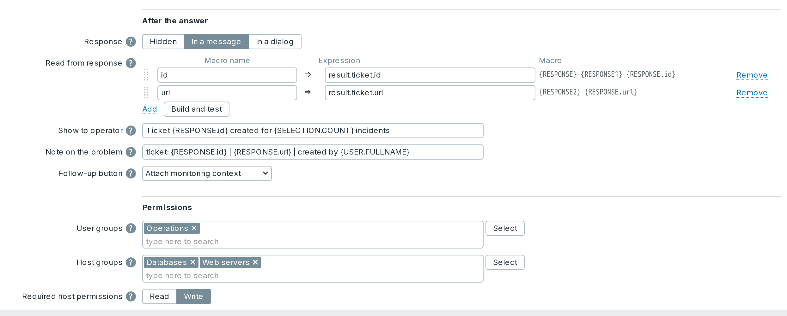 
<small><b>Response workflow and permissions (PRO)</b> - The lower part of the same Create ticket definition pairs extracted response values, operator feedback, a problem note and a follow-up with User groups, Host groups and required Write access.</small>

Action requests accept absolute `http://` or `https://` endpoints only. **Frontend server** requests do not follow redirects: a 3xx response is checked against **Required status codes** like any other response. **Browser** requests follow the browser's normal redirect rules. The menu is shown only to users whose Zabbix role allows acknowledging problems, and script buttons also require permission to execute scripts; the server checks these permissions again when a button is pressed.

**Read from response**, **Show to operator**, **Note on the problem** and **Follow-up button** apply to **Frontend server** requests and scripts. **Browser** checks the HTTP status; **Open in a dialog** opens the URL. Neither uses that response workflow.

**Test** uses the unsaved definition on the card. A **Frontend server** or **Browser** test makes a real request from that sender. An **Open in a dialog** test resolves and validates the address and offers a link to open it. A script test asks for a host and optionally a problem's event id, and really executes the script there. For server requests and scripts, Test also previews the extracted values, operator message and problem note; it does not write the note or run the follow-up. **Clone** copies the card, including whether it is enabled.

A script button's card says when the button and its script disagree - the script refuses user input, or asks for a value the button does not collect - and offers to copy the script's own prompt, default, rule and confirmation in one click. Below Zabbix 7.0 a script runs without a value; a button with user input says so on the card.

## FREE vs PRO

The capabilities of the released FREE widget stay FREE, including unlimited Tag columns, the original Count extraction and regex, First occurrence tag, the one URL-tag context-menu link, manual filters, one sorting level and presets. PRO adds the new options listed below and keeps its presentation extras and action buttons. A section containing a new PRO control does not make the original FREE controls paid.

| Feature | FREE | PRO |
| ---------------------------------------------------------- | :----: | :----: |
| Choose and arrange the original columns, labels and widths | ✅ | ✅ |
| Font size and colour control, for wall displays read at a distance | ✅ | ✅ |
| Filter by host group, host, severity, tags and problem name | ✅ | ✅ |
| Acknowledge, unacknowledge, close and journal from the widget; time acknowledge from Zabbix 6.2 | ✅ | ✅ |
| Unlimited tag columns and the original Count, First occurrence tag and URL-tag context-menu link | ✅ | ✅ |
| Presets: save the widget's columns, sorting and appearance under a name and load it on any dashboard | ✅ | ✅ |
| Localised into all 27 Zabbix display locales | ✅ | ✅ |
| High availability ready | ✅ | ✅ |
| Host groups and hosts from another widget or the dashboard (Zabbix 7.0+) | ❌ | ✅ |
| Additional Update message columns, wildcard/regex Problem filters and sorting by arbitrary custom columns | ❌ | ✅ |
| Severity icon, Operational data and Duration columns; sticky headers; extra font choices and list styles | ❌ | ✅ |
| Per-column URL link templates, Select dashboard and Link target: Column or Context menu | ❌ | ✅ |
| Widget title and subtitle, each with its own font, colours and alignment, the subtitle with per-severity counts | ❌ | ✅ |
| Sorting by up to ten columns instead of one, display mode, acknowledge style | ❌ | ✅ |
| Severity colours of the widget's own - a wall screen's palette next to the frontend's | ❌ | ✅ |
| Action buttons: webhooks and Zabbix scripts, per problem or once for the whole selection, with macros, input, confirmation, response handling and permissions by user group and host group | ❌ | ✅ |
| Ticket workflow: one ticket for a selection, its number noted on every problem and shown in a column, already-handled problems skipped | ❌ | ✅ |
| Licence | AGPLv3 | [Commercial](./LICENSE-PRO.md) |

## Requirements

|              |                                                              |
| ------------ | ------------------------------------------------------------ |
| **Zabbix**   | 6.0 · 6.2 · 6.4 · 7.0 · 7.2 · 7.4 · 8.0 - one package covers all |
| **PHP**      | 7.4 or newer                                                 |
| **OS**       | Debian/Ubuntu · RHEL/Rocky/Alma/Oracle/Amazon · SUSE         |
| **Editions** | FREE (AGPLv3) and PRO (one-time commercial licence)            |
| **Localisation** | All 27 Zabbix display locales - the widget follows each user's own language setting |
| **High availability** | Ready. No server-side component and no local state; install it on every frontend node of an HA cluster and any node can serve it |

Zabbix accepts one module format below 6.4 and a different one from 6.4 up, so the package carries both and the frontend loads whichever it understands. Shared controls use the same settings in both formats. Version-specific capabilities are noted where they apply: time acknowledge from 6.2; PRO Host groups from another widget and Hosts from another widget or the dashboard, plus script manual input, from 7.0.

**Upgrading from 7.0-1 or earlier.** Below 6.4 that release stored a configuration of its own, and the two halves of the widget could not read each other's dashboards. Your existing widgets are carried over the first time they are opened - columns keep their order, widths and labels, tags you had listed under "Tag display priority" become custom columns with source *Tag*, and your font is preserved. Two settings from the old 6.0/6.2 form have no equivalent and are not approximated: **Show tags**, which showed the first one to three tags of a problem whichever they turned out to be (add a custom column with source *Tag* for each tag you want), and the **description length limit**, which truncated the problem name (set the Problem column's width instead).

## Support &amp; links

- **[Documentation / Wiki](https://www.initmax.com/wiki/enhanced-problems/)**
- **[Product page](https://www.initmax.com/product/enhanced-problems/)**
- **[Portal](https://portal.initmax.com)** - downloads, tokens, support tickets
- **Source code (FREE, AGPLv3)** - included in every package and published as a [source archive](https://repo.initmax.com/zabbix/free/zip/enhancedproblems/) on repo.initmax.com
- **[support@initmax.com](mailto:support@initmax.com)**

---

FREE: <a href="https://www.gnu.org/licenses/agpl-3.0.html">AGPLv3</a> &nbsp;·&nbsp; PRO: <a href="./LICENSE-PRO.md">commercial</a> &nbsp;·&nbsp; © 2021-2026 initMAX s.r.o.

