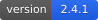
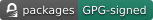
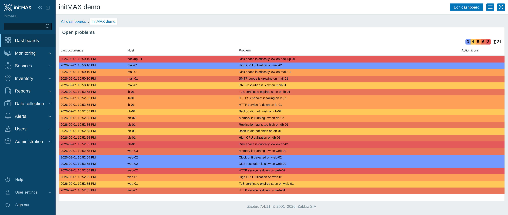
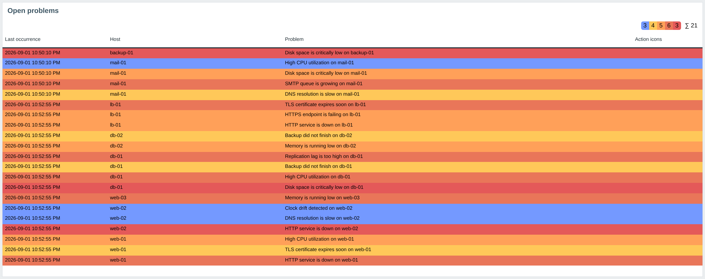
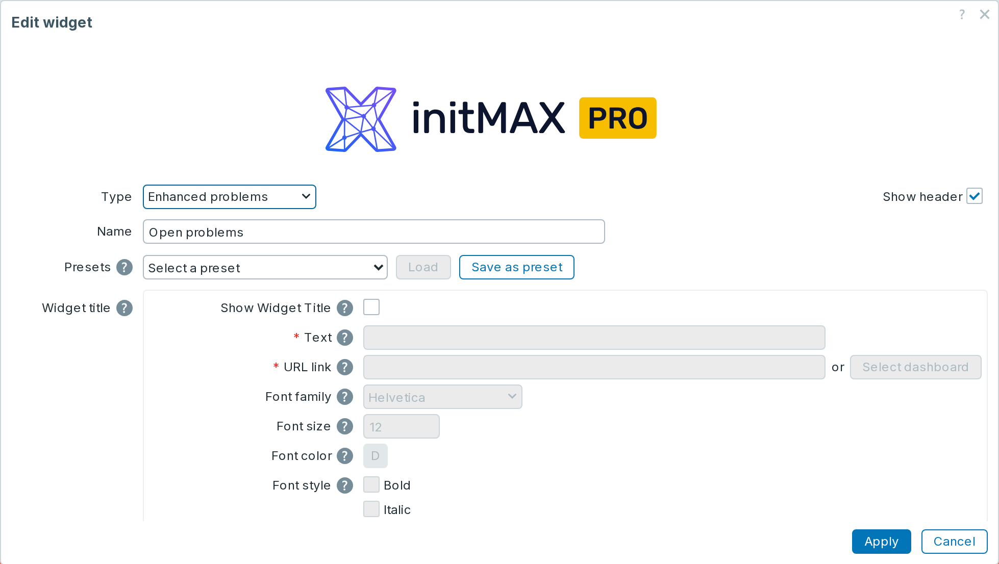
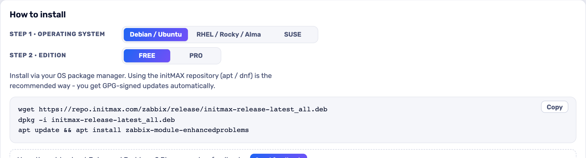

<h1>Enhanced Problems</h1>

developed and maintained by

and community

<strong>The Zabbix Problems widget, with the filtering and layout an operations wall actually needs.</strong> 
Zabbix's own Problems widget shows one list, the same way, for everyone looking at it. Enhanced Problems lets a dashboard say what this particular screen is for: which columns, how large, in what colour, and which problems belong on it at all.

<a href="#what-you-can-build"><strong>Features</strong></a> &nbsp;·&nbsp;
<a href="#examples"><strong>Examples</strong></a> &nbsp;·&nbsp;
<a href="#install"><strong>Install</strong></a> &nbsp;·&nbsp;
<a href="#free-vs-pro"><strong>FREE vs PRO</strong></a> &nbsp;·&nbsp;
<a href="https://portal.initmax.com"><strong>Portal</strong></a> &nbsp;·&nbsp;
<a href="https://www.initmax.com/wiki/enhanced-problems/"><strong>Docs</strong></a>

 

---

## Why Enhanced Problems

A problems list is the one widget that ends up on every wall display, every NOC screen and every team's own dashboard - and each of those wants something different from it. One wants the host column wide and everything else gone; another wants severity counts at a glance from ten metres away; a third wants to acknowledge without leaving the page.

Enhanced Problems is that widget with those decisions handed back to whoever builds the dashboard.

## What you can build

<table>
<tr>
<td width="50%" valign="top">

**Your own column set**

Choose which columns appear and how wide each one is - a problems list that fits the screen it runs on.

</td>
<td width="50%" valign="top">

**Readable from across the room**

Font size and colours are yours to set, made for wall displays.

</td>
</tr>
<tr>
<td width="50%" valign="top">

**Severity summary row**

Problem counts per severity on top of the list.

</td>
<td width="50%" valign="top">

**Acknowledge in place**

Acknowledge a problem straight from the widget, no detour to the Problems page.

</td>
</tr>
<tr>
<td width="50%" valign="top">

**Filter like the stock widget**

Host group, host, severity, tags and problem name.

</td>
<td width="50%" valign="top">

**Three-level sorting**

Sort by severity, then time, then host - or any order you prefer.

</td>
</tr>
</table>

## Examples

<table>
<tr>
<td width="50%" align="center" valign="top"> <small><b>Problems</b> - Twenty-one open problems across eight hosts, sorted by severity, with the per-severity counters in the summary row.</small></td>
</tr>
</table>

## Configuration

Everything lives in one familiar widget form.

## Install

**FREE** ships as **GPG-signed `deb` / `rpm` packages** from the initMAX repository - `apt` / `dnf` installs them and keeps them updated.

### Easiest way - the guided installer on the Portal

Open the product page, pick your **OS** and **edition**, and copy the ready-made command. FREE is fully public (no login); PRO fills in your token once you sign in. There's a feedback box right there too.

<a href="https://portal.initmax.com/catalog/zabbix-enhancedproblems#how-to-install"><strong>→ Open the installer on the Portal</strong></a>

Prefer a plain archive? Every release also ships as a **ZIP** [straight from the repo](https://repo.initmax.com/zabbix/free/zip/enhancedproblems/) - handy for offline or manual installs.

The module is enabled automatically during the package installation - verify it in **Administration → General → Modules**. Done.

## Action buttons (PRO)

An action button is a context-menu entry the administrator defines in **Administration → Enhanced Problems**: an HTTP request, shaped like an HTTP agent item (URL, query fields, headers, GET/POST, body), fired for every selected problem with the problem's macros filled in - `{EVENT.ID}`, `{EVENT.NAME}`, `{HOST.NAME}`, `{EVENT.TAGS.<name>}`, `{USER.USERNAME}`, `{MANUALINPUT}` and the rest are listed next to the form. Three worked examples:

**1. Create a ticket and record its number**

| field | value |
| --- | --- |
| Send from | Frontend server |
| Request type | POST · `https://helpdesk.example.com/api/tickets` |
| Headers | `Content-Type: application/json` · `Authorization: Bearer …` |
| Request body | `{"messageId": "ZBX{EVENT.ID}-{TIME}", "timestamp": "{DATETIME.ISO}", "title": "{EVENT.NAME}", "host": "{HOST.NAME}", "severity": "{EVENT.SEVERITY}", "zabbix_event": "{EVENT.ID}", "opened_by": "{USER.USERNAME}"}` |
| Read from response | `id ⇒ ticket.id` and `url ⇒ ticket.url` - the answer is `{"ticket": {"id": 4711, "url": "..."}}`; each row is a macro by number, `{RESPONSE1}` and `{RESPONSE2}`, and by name, `{RESPONSE.id}` and `{RESPONSE.url}` (the first row is also plain `{RESPONSE}`) |
| Show to operator | `Ticket {RESPONSE.id} created for {HOST.NAME}: {RESPONSE.url}` |
| Note on the problem | `ticket:{RESPONSE.id}` - lands in the problem's journal, where the Count and link columns can read it |
| Follow-up button | *Annotate ticket* (example 2) |

**2. Annotate the ticket that was just created** - the follow-up, fired with `{RESPONSE}` already filled in

| field | value |
| --- | --- |
| Request type | POST · `https://helpdesk.example.com/api/tickets/{RESPONSE}/notes` |
| Request body | `{"text": "Opened from Zabbix by {USER.FULLNAME}: {EVENT.NAME} on {HOST.NAME}, {EVENT.COUNT} occurrences, last {EVENT.LAST}"}` |
| Response | Hidden |

**3. Restart a service, ask which one first**

| field | value |
| --- | --- |
| Enable user input | on · prompt *Which service?* · Dropdown · `nginx, php-fpm, postgresql` |
| Confirmation | `Restart {MANUALINPUT} on {HOST.NAME}?` |
| Request type | POST · `https://automation.example.com/hooks/restart` · body `{"host": "{HOST.HOST}", "service": "{MANUALINPUT}"}` |
| Read from response | `job ⇒ /"job":\s*"([a-z0-9-]+)"/` - a regular expression, for an answer that is not JSON (the first capture group is taken); `header:Location` reads a response header instead |
| Show to operator | `Restart queued as job {RESPONSE.job}` |
| Response | In a message |

A tag the problem does not carry (`{EVENT.TAGS.CaseId}` on a problem without that tag) is sent as an empty string, so a ticket system never receives a macro's name as a value. The **Build and test** under "Read from response" is the tester a preprocessing step has: paste an answer or take the last real one, click the paths it lists to add rows, and watch the sentence and the note compose themselves. **4. Talk to Zabbix's own API** - a real one to copy: raise the problem's severity and leave a note, with an API token (Administration → API tokens)

| field | value |
| --- | --- |
| Request type | POST · `https://zabbix.example.com/api_jsonrpc.php` |
| Headers | `Content-Type: application/json-rpc` · `Authorization: Bearer <API token>` |
| Request body | `{"jsonrpc":"2.0","method":"event.acknowledge","params":{"eventids":["{EVENT.ID}"],"action":12,"severity":4,"message":"Raised to High by {USER.FULLNAME} ({DATETIME.ISO})"},"id":1}` |
| Read from response | `eventid ⇒ result.eventids.0` and `error ⇒ error.data` |
| Show to operator | `Severity of event {RESPONSE.eventid} raised to High {RESPONSE.error}` |
| Confirmation | `Raise "{EVENT.NAME}" on {HOST.NAME} to High?` |

The same shape reads anything back - `host.get` with `{"filter":{"host":["{HOST.HOST}"]}}` and `result.0.name`, `result.0.interfaces.0.ip` shown *in a dialog*, or `trigger.get` with `{TRIGGER.ID}` and `expandExpression`.

Action requests accept absolute `http://` or `https://` endpoints only. Redirects are returned to the operator as 3xx responses and are not followed, so credentials and request bodies are never forwarded to an unvalidated destination. The menu is shown only to users whose Zabbix role allows acknowledging problems; the server checks the same permission again when a button is pressed.

Everything done *with* the answer - reading, showing, the note, the follow-up - applies to buttons sent by the frontend server; a request the operator's browser makes never passes through it. **Test** on each card fires the definition as it stands, asks for a value per macro, and prints the status, the resolved address, the value read out, the sentence the operator would see and the note that would be written.

## FREE vs PRO

The core widget is FREE, under AGPLv3, and stays that way. PRO adds the presentation extras (widget title block, summary row, second and third sorting level, display mode, acknowledge style) and the action buttons above.

| Feature | FREE | PRO |
| ---------------------------------------------------------- | :----: | :----: |
| Choose which columns appear, and how wide each one is | ✅ | ✅ |
| Font size and colour control, for wall displays read at a distance | ✅ | ✅ |
| Filter by host group, host, severity, tags and problem name | ✅ | ✅ |
| Acknowledge, unacknowledge, close and journal from the widget; time acknowledge from Zabbix 6.2 | ✅ | ✅ |
| Configurable Count / first-occurrence / link sources (tags or update messages) | ✅ | ✅ |
| Localised into all 25 Zabbix display languages | ✅ | ✅ |
| High availability ready | ✅ | ✅ |
| Widget title block and summary row with per-severity counts | ❌ | ✅ |
| Second and third sorting level, display mode, acknowledge style | ❌ | ✅ |
| Severity colours of the widget's own - a wall screen's palette next to the frontend's | ❌ | ✅ |
| Action buttons: HTTP calls per problem, with macros, input, confirmation, response handling | ❌ | ✅ |
| Licence | AGPLv3 | [Commercial](./LICENSE-PRO.md) |

## Requirements

|              |                                                              |
| ------------ | ------------------------------------------------------------ |
| **Zabbix**   | 6.0 · 6.2 · 6.4 · 7.0 · 7.2 · 7.4 - one package covers all    |
| **PHP**      | 7.4 or newer                                                 |
| **OS**       | Debian/Ubuntu · RHEL/Rocky/Alma/Oracle/Amazon · SUSE         |
| **Editions** | FREE (AGPLv3) and PRO (one-time commercial licence)            |
| **Languages** | All 25 Zabbix display languages - the widget follows each user's own language setting |
| **High availability** | Ready. No server-side component and no local state; install it on every frontend node of an HA cluster and any node can serve it |

Zabbix accepts one module format below 6.4 and a different one from 6.4 up, so the package carries both and the frontend loads whichever it understands. What a customer configures, and what the widget draws, is the same on every version in that range: the same fields, under the same names, storing the same values - so a dashboard can move across 6.4 in either direction with nothing lost.

**Upgrading from 7.0-1 or earlier.** Below 6.4 that release stored a configuration of its own, and the two halves of the widget could not read each other's dashboards. Your existing widgets are carried over the first time they are opened - columns keep their order, widths and labels, tags you had listed under "Tag display priority" become tag columns, and your font is preserved. Two settings from the old 6.0/6.2 form have no equivalent and are not approximated: **Show tags**, which showed the first one to three tags of a problem whichever they turned out to be (name the tags you want and the widget gives each one a column), and the **description length limit**, which truncated the problem name (set the Problem column's width instead).

## Support &amp; links

- **[Documentation / Wiki](https://www.initmax.com/wiki/enhanced-problems/)**
- **[Product page](https://www.initmax.com/product/enhanced-problems/)**
- **[Portal](https://portal.initmax.com)** - downloads, tokens, support tickets
- **Source code (FREE, AGPLv3)** - included in every package and published as a [source archive](https://repo.initmax.com/zabbix/free/zip/enhancedproblems/) on repo.initmax.com
- **[support@initmax.com](mailto:support@initmax.com)**

---

FREE: <a href="https://www.gnu.org/licenses/agpl-3.0.html">AGPLv3</a> &nbsp;·&nbsp; PRO: <a href="./LICENSE-PRO.md">commercial</a> &nbsp;·&nbsp; © 2021-2026 initMAX s.r.o.

